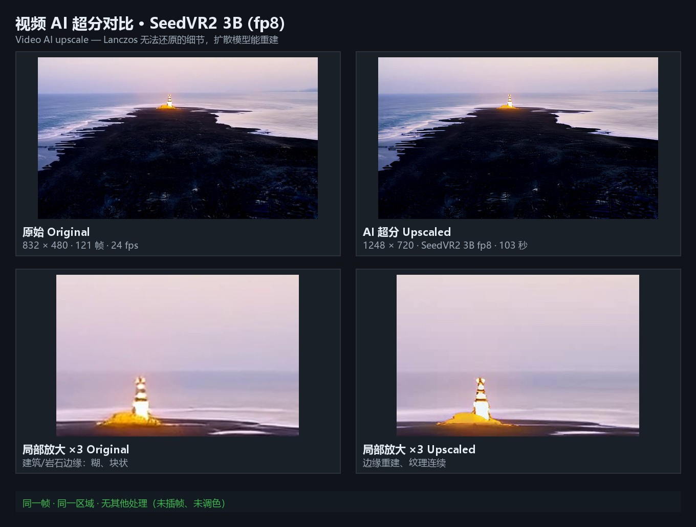
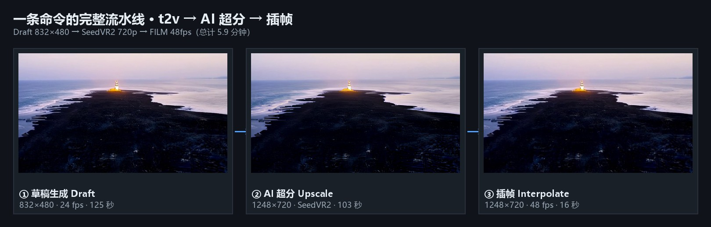

# Qwen-Image Local Pipeline

**A fully local image → video → post-processing pipeline.** Text-to-image, instruction-based editing,
image-to-video, AI upscaling, frame interpolation, video chaining and concatenation — all on your own GPU.
No cloud API, no network calls at generation time.

[中文说明见下方 ↓](#中文说明)

| Video AI upscale (SeedVR2 3B) | One-command pipeline |
|---|---|
|  |  |

---

## Why this exists

Most local-image projects stop at "generate one picture". Getting a **finished video** still requires gluing
together half a dozen tools by hand: pick a video model, learn its frame-count constraints, upscale without
blowing up VRAM, interpolate frames, chain segments to go beyond the length limit.

This repo is that glue — small PowerShell scripts, one config file, and measured numbers behind every default.

## Features

| Module | Capability | Notes |
|---|---|---|
| Text-to-image | Qwen-Image 2.1 Turbo / Z-Image Turbo | 15 s / 4 s for 1024² |
| Image-to-image | strength-controlled redraw | 20–25 s |
| Instruction edit | Qwen-Image-Edit-2511 | "replace the sky with a sunset" → only the sky changes |
| Image-to-video | Wan 2.2 TI2V-5B | 5 s clip in ~2 min |
| Video restyle | keyframe redraw + interpolation | style transfer without VACE/H3 |
| AI upscale (video) | SeedVR2 3B official CLI | temporal-aware, no flicker; 720p 103 s, 1080p 265 s |
| AI upscale (image) | SeedVR2 single-image mode | 2K / 4K, ~15–100 s |
| Frame interpolation | FILM | 24 → 48 fps in ~15 s |
| Chain / concat / trim | PyAV re-encode | auto-unifies resolution and frame rate |

## Hardware

| VRAM | What works |
|---|---|
| 24 GB (tested: RTX 5090 Laptop) | everything, including 1080p upscale |
| 16 GB | video at 640², upscale at 720p, batch 9 |
| 12 GB | images only + low-res video |
| < 12 GB | images only |

Reserve **100 GB+ disk** (models ≈ 60 GB + outputs).

## Quick start

```powershell
# 1) dependencies: stable-diffusion.cpp, ComfyUI (+GGUF), SeedVR2 CLI, Python w/ av+pillow
#    model links, sizes and licences: NOTICE.md

# 2) configure
Copy-Item config.sample.ps1 config.ps1
notepad config.ps1

# 3) run
scripts\video.ps1 -Action t2v -Prompt "lighthouse on a dusk coastline" -Seconds 5 -Preset draft
scripts\video.ps1 -Action upscale -Video out.mp4 -Preset final
scripts\img-upscale.ps1 -Image still.png -Resolution 2160
```

## Commands

| Task | Command |
|---|---|
| Text-to-image | `scripts\t2i.ps1 -Prompt "..."` |
| Fast T2I (Z-Image) | `scripts\t2i-zimage.ps1 -Prompt "..." -Width 832 -Height 1216` |
| Photoreal T2I (MOSS) | `scripts\t2i-moss.ps1 -Prompt "..." -Lora your-style.safetensors` |
| Video **with audio** | `scripts\ai-video-h3.ps1 -Prompt "... 海浪声，鸟鸣" -Seconds 5` |
| Redraw / restyle | `scripts\img2img.ps1 -Image x.png -Prompt "..." -Strength 0.85` |
| Instruction edit | `scripts\edit.ps1 -Image x.png -Prompt "replace sky with sunset"` |
| Image upscale 2K/4K | `scripts\img-upscale.ps1 -Image x.png -Resolution 1440\|2160` |
| Image-to-video | `scripts\i2v.ps1 -Image x.png -Prompt "slow dolly in" -Seconds 5` |
| Extend a clip | `scripts\extend.ps1 -Video x.mp4 -Segments 2` |
| Concatenate | `scripts\concat.ps1 -Videos "a.mp4,b.mp4"` |
| Trim | `scripts\trim.ps1 -Video x.mp4 -Start 1 -Duration 3` |
| Video AI upscale | `scripts\ai-upscale.ps1 -Video x.mp4 -Resolution 720` |
| Lanczos + interpolate | `scripts\post.ps1 -Video x.mp4 -Scale 1.5 -Interp 2` |
| Video restyle | `scripts\restyle.ps1 -Video x.mp4 -Prompt "watercolor" -Every 8` |

`scripts\video.ps1` is the dispatcher: `-Action t2v|i2v|extend|join|trim|upscale|restyle`
with `-Preset draft|fast|final`.

## Measured benchmarks (RTX 5090 Laptop, 24 GB)

| Task | Spec | Time | Peak VRAM |
|---|---|---|---|
| Text-to-image | 1024², 8 steps | 15 s | ~15 GB |
| Image-to-video | 736², 121 frames | 185 s | ~16 GB |
| Text-to-video | 832×480, 5 s | 125 s | ~16 GB |
| Text-to-video | 1280×720, 5 s | 362 s | ~20 GB |
| Video upscale | →720p, 121 frames | 103 s | 15.9 GB |
| Video upscale | →1080p, 121 frames | 265 s | 11.6 GB |
| Video upscale (FlashVSR+) | →1664×896, 121 frames | 76 s | 23.3 GB |
| Image upscale | →4K | 102 s | — |
| Interpolate ×2 | 121 → 241 frames | 15–25 s | low |
| Concat two clips | 7 s result | 2.5 s | CPU |
| End-to-end `t2v + final` | still → video → upscale → 48 fps | **5.9 min** | 16 GB |

Core insight: **generate at 832×480, then upscale.** That is 2.4× faster than generating 720p directly,
and because interpolation comes after, motion ends up smoother too.

## Layout

```
scripts\
  video.ps1        dispatcher (actions + presets)
  t2i.ps1          text-to-image
  img2img.ps1      image-to-image
  edit.ps1         instruction edit
  i2v.ps1          image-to-video
  extend.ps1       chain clips
  concat.ps1       concatenate
  trim.ps1         trim
  post.ps1         Lanczos + FILM interpolation
  ai-upscale.ps1   SeedVR2 video upscale
  ai-upscale-flashvsr.ps1  FlashVSR+ high-res upscale
t2i-zimage.ps1   Z-Image Turbo fast T2I (+ style LoRA / img2img)
t2i-moss.ps1     MOSS-Image photoreal T2I
ai-video-h3.ps1  MiniMax H3 text-to-video with audio
lib/vram.ps1     VRAM snapshot: stop local chat models, restore after
  img-upscale.ps1  SeedVR2 image upscale
  restyle.ps1      keyframe restyle
  organize.ps1     output numbering + metadata
  lib\             config loader, media probe, PyAV tools
docs\              per-module guides + 13-class pitfall list
assets\            cheat sheet (HTML) + comparison images
```

## Design notes

1. **No model weights in this repo.** Licences allow use, not redistribution. Scripts fail with a clear
   message pointing at `NOTICE.md` when a file is missing.
2. **ComfyUI is driven over HTTP**, not through its UI, so every step is scriptable.
3. **AI upscale uses SeedVR2's official CLI**, because the ComfyUI template for it is a frontend subgraph
   that cannot be submitted through `/prompt`.
4. **Every script prints a parameter summary** — resolution, fps, duration, frames, codec, bitrate, audio, size.

## Licence

Scripts and docs: **MIT**. Third-party models and software keep their own licences — see [NOTICE.md](NOTICE.md).
Nothing here grants rights to model weights.

---

## 中文说明

**一条命令完成「图 → 视频 → 后期」的全本地流水线。** 文生图、指令编辑、图生视频、AI 超分、
插帧、续接拼长片，全部跑在自己的显卡上，生成过程不联网。

### 为什么做这个

多数本地出图项目止步于"生成一张图"。要拿到**成片**，还得自己把五六个工具串起来：挑视频模型、
摸清帧数约束、超分还不能爆显存、再插帧、再分段拼长片。

这个仓库就是那层胶水：小脚本 + 一个配置文件，每个默认值背后都有实测数据。

### 能力

| 模块 | 能力 | 说明 |
|---|---|---|
| 文生图 | Qwen-Image 2.1 Turbo / Z-Image | 1024² 约 15 秒 / 4 秒 |
| 图生图 | 强度可控重绘 | 20~25 秒 |
| 指令编辑 | Qwen-Image-Edit-2511 | 「把天空换成夕阳」只改天空 |
| 图生视频 | Wan 2.2 TI2V-5B | 5 秒片子约 2 分钟 |
| 视频改风格 | 关键帧重绘 + 插帧回填 | 不需要 VACE/H3 |
| **AI 超分** | SeedVR2 3B 官方 CLI | 带时序、不闪；720p 103 秒 / 1080p 265 秒 |
| **超高分辨率** | FlashVSR+（triton 稀疏） | 1664×896 / 76 秒，吃满 24GB 显存 |
| 图片超分 | SeedVR2 单图模式 | 2K / 4K，约 15~100 秒 |
| 插帧 | FILM | 24 → 48fps 约 15 秒 |
| 续接 / 拼接 / 裁剪 | PyAV 重编码 | 自动统一分辨率与帧率 |

### 快速开始

```powershell
Copy-Item config.sample.ps1 config.ps1   # 改成你的路径
scripts\video.ps1 -Action t2v -Prompt "黄昏海岸的灯塔" -Seconds 5 -Preset draft
scripts\video.ps1 -Action upscale -Video out.mp4 -Preset final
scripts\img-upscale.ps1 -Image still.png -Resolution 2160
```

### 关键词对照（说人话就行）

| 你说 | 走的路线 |
|---|---|
| 画一张 / 出图 | `t2i.ps1` |
| 要快（4 秒） | `t2i-zimage.ps1` |
| 写实人像 | `t2i-moss.ps1` |
| 带声音的视频 | `ai-video-h3.ps1` |
| 改成水彩风 | `img2img.ps1`（提示词写目标画面） |
| 把天空换成夕阳 | `edit.ps1`（提示词写指令，一次只改一件事） |
| 放大 | `post.ps1 -Scale`（Lanczos，秒级，不增细节） |
| **超分 / 变清晰** | `ai-upscale.ps1`（SeedVR2，慢但真重建） |
| 插帧 / 更流畅 | `post.ps1 -Interp` |
| 接起来 / 再接两段 | `concat.ps1` / `extend.ps1` |

### 实测基准（RTX 5090 Laptop 24GB）

见上方英文表格。核心结论：**草稿用 832×480 生成，满意后再超分**——比直接生成 720p 快 2.4 倍，
而且因为多了插帧这一步，运动反而更顺。

### 文档

- [docs/01-image.md](docs/01-image.md) 文生图 / 图生图 / 指令编辑（含 sigma 陷阱、强度阈值）
- [docs/02-video.md](docs/02-video.md) 图生视频 / 文生视频 / 续接（含 4n+1 帧规则）
- [docs/03-upscale.md](docs/03-upscale.md) SeedVR2 安装与超分（含 1080p 为什么会爆显存）
- [docs/04-video-edit.md](docs/04-video-edit.md) 拼接 / 裁剪 / 放大 / 插帧
- [docs/05-pitfalls.md](docs/05-pitfalls.md) **13 类踩坑清单**（BOM、中文路径、4n+1、显存…）
- [docs/06-new-models-and-vram.md](docs/06-new-models-and-vram.md) Z-Image / MOSS / H3 三模型 + 显存快照 + 降级策略
- [skills/README.md](skills/README.md) **给 AI 助手用的技能包**（6 个 SKILL.md：选型路由、参数、降级、交付规范）

### 许可证

脚本与文档 **MIT**。第三方模型和软件各自许可，见 [NOTICE.md](NOTICE.md)，本项目不授予任何模型权重权利。
